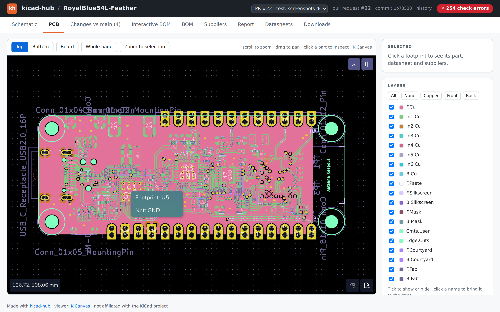
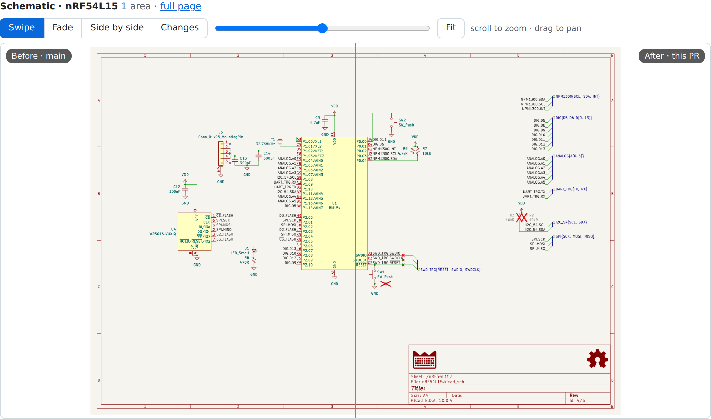
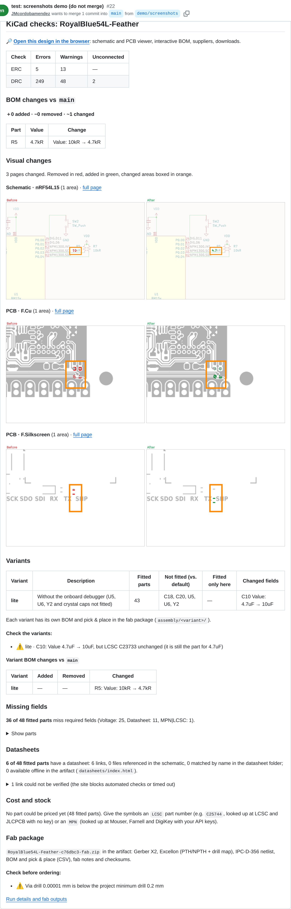

# kicad-hub

Git-based hardware design review for KiCad, running entirely on GitHub.

The goal is the collaboration experience of commercial PCB cloud platforms
(design checks, BOM review, release packages, web viewer, visual diffs) for KiCad
projects, using only free and open-source tools on top of plain git, GitHub Actions
and GitHub Pages. No extra server to maintain.

kicad-hub is an independent project, not affiliated with or endorsed by the KiCad
project. KiCad is a trademark of its respective owners.

> **Status:** v1.1 — CI checks, BOM review, suppliers, fab package and the design
> portal with interactive compare work and are tested on every push with a real
> board (see [what works today](#what-works-today)). Next steps: the
> [roadmap](docs/ROADMAP.md).

New here? Read the [manual](docs/manual.md).



| Changed sheet, swipe between before and after | The report posted on the pull request |
|---|---|
|  |  |

More: [schematic](docs/screenshots/portal-schematic.png) ·
[BOM](docs/screenshots/portal-bom.png). Real screenshots of the example board's
portal and PR comment, taken by the "Docs screenshots" workflow.

## What works today

On every push and pull request of a KiCad project, the action:

- **Checks the design**: ERC and DRC (plus schematic/PCB parity) with `kicad-cli`.
  Non-blocking by default; `strict: true` fails the job on errors.
- **Checks the BOM**: every fitted part needs the required fields (by default
  footprint, datasheet and MPN or LCSC code); capacitors need a voltage rating.
- **Checks your requirements**: a `kicad-hub-requirements.yaml` next to the project
  (cost per board, layers, board size, stock, parts...) is checked on every run and
  shown as a pass/fail table; `strict: true` fails the job on a failed requirement.
- **Diffs the BOM** of a pull request against its target branch: parts added,
  removed and changed (`Value: 10uF → 22uF`).
- **Resolves the datasheets**: links checked (broken vs. unverifiable), local PDFs
  found by MPN or value in the datasheet folders and bundled for offline use.
- **Prices the BOM from several suppliers**: price and stock of every part at LCSC
  and JLCPCB (no API key needed) and at Mouser, Farnell and DigiKey (with your own
  free API keys); cost per board and per batch (1, 5, 10, 100 boards) for every
  variant; a page to compare offers part by part and choose the supplier, saved in
  the repo. Warns on parts out of stock, not active, not found, or whose LCSC code
  doesn't match the MPN.
- **Builds a fab package** in standard formats any fab house accepts (Gerber X2,
  Excellon, IPC-D-356, BOM and pick & place CSV) with fab notes read from the
  board, which warn about features below the project rules.
- **Reports** all of the above in the job summary and as **one comment on the PR**,
  updated on every push.
- **Builds every design variant** (KiCad 10 variants, read from the project): the
  report lists what each one fits, leaves out or changes, warns when a variant
  changes a value but keeps the part number, diffs each variant in pull requests,
  and the fab package gets a BOM and pick & place per variant.
- **Shows before/after images** of the schematic sheets and PCB layers changed in a
  pull request, right in the PR comment: removed in red, added in green, each
  changed area boxed.
- **Publishes a design portal** on GitHub Pages: one page per branch, release and
  pull request with the schematic and PCB in the browser
  ([KiCanvas](https://kicanvas.org)), the report, interactive BOM, supplier
  comparison, datasheets and downloads; the PR comment links to it. Keeps a **timeline**
  of the last commits of `main` and the releases, a page to **compare any two
  versions** (BOM, schematic sheets, PCB layers) and an **activity** page with the
  branch graph, pull requests, reviews, comments and pushes.
- **Publishes a GitHub Release** with the fab package when you tag `vX.Y`.
- Also: schematic PDF, BOM (CSV/HTML) and interactive BOM.

A board still being drawn (no outline on `Edge.Cuts`) skips DRC and the PCB outputs
with a warning instead of failing.

## Planned

Details and progress: [roadmap](docs/ROADMAP.md).

## How the pieces fit together

```
 KiCad (each designer)
        │  git push / pull request / tag
        ▼
 GitHub repository ──► GitHub Actions ── kicad-hub action (Docker: KiCad 10 + KiBot)
                          │
                          ├─ kicad-cli ── ERC / DRC
                          │            ── per-part BOM (this commit + PR base)
                          │            ── SVG of every sheet/layer (this commit + PR base)
                          │            ── fab package: Gerber X2, Excellon,
                          │               IPC-D-356, BOM, pick & place
                          ├─ Python ──── scripts/datasheets.py  resolve, check, bundle
                          │            ── scripts/fabnotes.py    fab notes from the board
                          │            ── scripts/sourcing.py    cost and stock (LCSC, JLCPCB,
                          │                                      Mouser, Farnell, DigiKey)
                          │            ── scripts/visual_diff.py before/after images
                          │            ── scripts/renders.py     page renders for the compare page
                          │            ── scripts/activity.py    branches, PRs, pushes for the activity page
                          │            ── scripts/report.py      markdown report
                          ├─ KiBot ───── schematic PDF, BOM CSV/HTML, iBOM
                          │
                          ├──► job summary + sticky PR comment (images: branch kicad-hub-images)
                          ├──► design portal (branch kicad-hub-site → GitHub Pages)
                          ├──► artifact <board>-fab
                          └──► GitHub Release (on tags)

 GitHub Pages (branch kicad-hub-site): design portal, one page per branch / release / PR
```

`kicad-cli` is used wherever possible: it respects the settings saved in the
project (plot layers, rules) and its options are stable. KiBot is kept for the
outputs it does best.

## Usage

kicad-hub is a GitHub Action. A board repository only needs a small workflow:

```yaml
# .github/workflows/kicad.yml in your board repository
name: KiCad

on:
  push:
    branches: [main]
    tags: ["v*"]         # tagging vX.Y publishes the fab package as a release
  pull_request:

permissions:
  contents: write        # releases and PR images (read = neither)
  pull-requests: write   # PR comment with the report

jobs:
  board:
    runs-on: ubuntu-latest
    steps:
      - uses: actions/checkout@v4
        with:
          lfs: true
      - uses: JMcordobamendez/kicad-hub@v1
        with:
          project-dir: hardware/my-board   # folder with the .kicad_pro
```

Ready-made workflows are in [`template/.github/workflows/`](template/.github/workflows/):
`kicad.yml` (the one above, with every option and the supplier keys) and
`kicad-hub-cleanup.yml`, which removes a pull request's before/after images and its
portal page when it is closed (or by hand, *Run workflow* with a PR number). Copy both to `.github/workflows/` in your board repository.

**Versions:** `@v1` always points to the latest 1.x release (no breaking changes);
pin a full tag such as `@v1.0.0` to freeze it, or use `@main` for the development
version.

### Inputs

| Input | Default | What it does |
|---|---|---|
| `project-dir` | — | Folder with the `.kicad_pro` (required) |
| `strict` | `false` | Fail on ERC/DRC errors or a failed requirement |
| `required-fields` | `Footprint,Datasheet,MPN\|LCSC` | Fields every fitted part needs; `A\|B` = either |
| `check-capacitor-voltage` | `true` | Capacitors need a `Voltage` field or a value like `10uF 16V` |
| `datasheet-dirs` | — | Extra folders with datasheet files (matched by MPN or value) |
| `datasheet-optional-refs` | `R,C,TP,H,MH,FID,JP,NT,LOGO` | Prefixes that don't need a datasheet |
| `check-datasheet-links` | `true` | Check that datasheet URLs respond |
| `variants` | `auto` | Design variants to build: `auto` (all in the project), a list, or `none` |
| `sourcing` | `true` | Price and stock per supplier, and the comparison page |
| `boards` | `1,5,10,100` | Batch sizes to price (components only) |
| `currency` | `USD` | Currency for all prices (converted with ECB rates) |
| `sourcing-choices` | `kicad-hub-sourcing.csv` | Supplier picked per part, relative to `project-dir` (see [choosing suppliers](#choosing-suppliers)) |
| `mouser-api-key` | — | Mouser Search API key, from a secret ([how](#supplier-api-keys)) |
| `farnell-api-key` | — | Farnell / element14 API key, from a secret |
| `farnell-store` | `uk.farnell.com` | Farnell store to price from (`es.farnell.com`, `de.farnell.com`, `www.newark.com`…) |
| `digikey-client-id` | — | DigiKey API client ID, from a secret |
| `digikey-client-secret` | — | DigiKey API client secret, from a secret |
| `requirements` | `kicad-hub-requirements.yaml` | Requirements file, relative to `project-dir` (see [requirements](#requirements)); no file = nothing checked |
| `pages` | `true` | Publish the design portal (see [design portal](#design-portal)) |
| `pages-branch` | `kicad-hub-site` | Branch the portal is published to |
| `history` | `10` | Light snapshots of the last N commits of the default branch for the portal's timeline and compare page; `0` = off |
| `activity` | `500` | Activity page of the portal: graph of the last N commits of all branches, pull requests, reviews, comments, releases and pushes (see [activity](#activity)); `0` = off |
| `visual-diff` | `true` | On PRs, before/after images of the changed sheets and layers in the comment (stored in the `kicad-hub-images` branch) |
| `fab-profile` | `generic` | Optional fab layer: `jlcpcb`, `pcbway` or `eurocircuits` (see [fab profiles](#fab-profiles)) |
| `extra-formats` | — | Extra formats in the fab package: `odb`, `ipc2581` |
| `release` | `true` | On tags, attach the fab package to a GitHub Release |
| `comment` | `true` | Post the report on the PR |
| `github-token` | `github.token` | Token for the PR comment and the release |
| `image` | `ghcr.io/inti-cmnb/kicad10_auto:1.9.1` | Docker image with KiCad and KiBot |
| `output-dir` | `fab` | Where outputs are written |

Outputs: `has-pcb`, `missing-fields`, `requirements-failed`.

Datasheet folders searched by default: `datasheet(s)/` and `docs/` next to the
project, and `datasheet(s)/` one level up. A file is used when its name contains
the part's MPN or value, or its family code (`S-82A2A_B_C.pdf` →
`S-82A2AAA-A8T2U`).

### Fab profiles

The package and the checks are generic by default. `fab-profile` adds an optional
layer for one fab, without changing the project's own DRC or `strict`:

- **DRC vs the fab's rules**: a second DRC on a copy of the project, with the fab's
  published capabilities (`fab-profiles/<name>/rules.kicad_dru`) appended to the
  project's own `.kicad_dru`. Shown as its own line in the report, the PR comment and
  the portal; the artifact has `reports/drc-fab.rpt|json`. It never fails the build.
- **Assembly files** in the fab's column layout, next to the generic ones
  (`assembly/jlcpcb/`: BOM `Comment, Designator, Footprint, LCSC Part #` from the
  `LCSC` field, and CPL `Designator, Mid X, Mid Y, Layer, Rotation`).
- A note in the package's `README.txt`.

| Profile | Rules | Assembly files |
|---|---|---|
| `jlcpcb` | standard 2-layer/multilayer, 1 oz | yes |
| `pcbway` | standard process, 1 oz | no (generic files) |
| `eurocircuits` | only limits independent of the pattern class | no (generic files) |

Each `rules.kicad_dru` cites its source page and date. KiCad rules can't test the
layer count, so where 2-layer and multilayer limits differ the safer value is used.

### Design portal

Every push to a branch, tag and pull request publishes a page to the
`kicad-hub-site` branch, served by GitHub Pages at
`https://<owner>.github.io/<repo>/`:

- `/<branch>/` (e.g. `/main/`), `/releases/<tag>/`, `/pr-<N>/`, and a front page
  listing them all;
- each page has tabs: **Schematic** (sheet picker) and **PCB** (top/bottom, layer
  list with presets), both with pan, zoom and a side panel that shows the clicked
  part (value, footprint, nets, datasheet, best supplier offers); on pull requests,
  **Changes vs <base>** (BOM changes, and each changed sheet or layer in an interactive
  compare: swipe, fade, side by side or red/green changes, with zoom and pan); then **Interactive
  BOM**, **BOM**, **Suppliers**, **Report**, **Datasheets** and **Downloads** (fab
  package, schematic PDF, BOM CSV, commit history);
- a version picker in the top bar jumps between branches, the history of `main`,
  releases and PRs, and opens the timeline or the compare page;
- **History** (front page, `#history`): the last commits of `main` (input `history`,
  default 10, `0` = off) and the releases, newest first, with date, commit, message,
  author, ERC/DRC status, **Open**, **Compare with previous** and **Compare with…**.
  Each push to `main` adds a light snapshot at `/history/<short-sha>/` (design files if
  under 6 MB, page renders, parts BOM, commit info; no fab package, offers or PDFs) and
  the oldest beyond `history` are removed. Releases keep their full pages;
- **Compare** (`/compare.html`, or `compare.html?a=<path>&b=<path>` with paths such as
  `main/`, `history/<sha>/`, `releases/<tag>/`, `pr-3/`): pick any two versions. It shows
  the BOM changes (added, removed, changed fields) and every schematic sheet and PCB layer
  in the interactive compare (swipe, fade, side by side, or **Changes**: red only in A,
  green only in B), computed in the browser from full-page renders that every published
  build stores in `renders/` (same export options and resolution, no crop, so any two
  builds line up). Pages identical in both are collapsed as "no changes". Builds
  published before this feature have no renders until their next publish.
- **Activity** (`/activity.html`, linked from the front page and the top bar): how the
  work evolved, see [below](#activity);
- on pull request pages, **comments pinned on the board** (see below).

The viewer is a pinned copy of KiCanvas (`scripts/vendor/`, see its README), not
loaded from a third-party site, so published pages don't change under you.

**Turn it on once:** after the first run, *Settings → Pages → Build and deployment →
Source: Deploy from a branch → `kicad-hub-site` / `(root)` → Save*. The PR comment
links to the PR's page. The branch keeps a single commit, replaced on every
publish, so it doesn't grow; the cleanup workflow removes a PR's page when it is
closed. Pull requests from forks aren't published (they can't write to the repo).

#### Activity

`activity.html` draws the history of the repository: a lane graph of the last commits of
every branch and tag (newest on top, one colour per lane, merge curves, a star on
releases) next to a table of subject, author, date and commit, and a feed of what
happened, newest first: pull requests opened, reviewed (approved, changes requested,
commented), commented, merged or closed, pushes, releases. A chip at each branch tip
shows who created the branch: the author of its pull request, else of its first commit,
else whoever pushed it first. Hover (or focus, or tap) a feed item to highlight its
commits in the graph, and a commit to highlight its feed items. Click a commit for its
actions: open the portal page of that commit if one was published (`history/<sha>/`,
`main/`, a release, a PR), *Compare with parent* when both have one, or the commit on
GitHub. Filters: branch, author, dates, and *only main + open PRs*. Everything is drawn
in the browser from `activity.json` (no libraries), rebuilt on every publish.

- **Data**: git (all branches and tags in topological order; a shallow checkout is
  deepened and all branches are fetched, so the graph is complete without
  `fetch-depth: 0`) and the GitHub GraphQL API with the action's `github-token` (the last
  100 pull requests with their reviews and comments, and releases). Without the token or
  when GitHub doesn't answer, the page shows the git graph alone.
- **Pushes**: GitHub doesn't keep who pushed a branch, so every run of a push (and every
  update of a pull request's branch) appends `{actor, ref, before, after, date}` to
  `activity-pushes.json` in the site branch (the last 1000). Pushes made before the first
  run with this feature are not known; the page says since when it records.
- **Privacy**: no e-mail address is ever published. Authors are shown by GitHub login (and
  avatar from `avatars.githubusercontent.com`) when known, else by the name in the commit,
  and anything that looks like an address is removed from commit subjects and comments.
- Input `activity` sets how many commits to read (default 500, `0` = no page). Pull requests
  from forks aren't published, so they never reach it.

#### Comments on the board

On a pull request's page, the **PCB** and **Schematic** tabs have a **Comment** button.
Press it, click a part or any point of the board (or type the coordinates), write the
note and post it: it becomes a normal comment in the pull request's conversation,

```
📍 **U12** (x 23.40, y 41.10 mm, F.Cu) — missing decoupling

[Open on the board](https://<owner>.github.io/<repo>/pr-7/?at=23.4,41.1&ref=U12#pcb)
<!-- kicad-hub-pin {"ref":"U12","x":23.4,"y":41.1,"layer":"F.Cu","page":"pcb","sha":"…"} -->
```

with a hidden marker that the portal reads back. The **Comments** card in the side
panel lists the pins of that tab (author, part, text, link to the GitHub comment);
click one to select and zoom to the part (or the point), and numbered markers are
drawn over the viewer and follow pan and zoom. The link in the comment opens the page
on that spot. Anyone can also write such a comment by hand: the marker is all it needs.
Branch and release pages don't show comments.

Reading the pins needs nothing (public repositories, 60 anonymous requests per hour).
**Posting** from the page needs a token; without one, **Comment** copies the formatted
comment to the clipboard and opens the pull request, where you paste it.

*Make the token once* (GitHub, in the browser):

1. Click your profile photo, top right → **Settings**.
2. Left sidebar, at the bottom → **Developer settings**.
3. **Personal access tokens** → **Fine-grained tokens** → **Generate new token**.
4. **Token name**: `kicad-hub comments`. **Expiration**: 30 days is plenty.
5. **Resource owner**: the owner of the board repository (an organization may need to
   allow fine-grained tokens, or approve the request).
6. **Repository access** → **Only select repositories** → pick the board repository.
7. **Permissions** → **Repository permissions** → **Pull requests** → *Access:*
   **Read and write** (Metadata: Read-only is added by itself). Nothing else.
8. **Generate token**, copy it (`github_pat_…`) and paste it in the **GitHub token**
   box at the bottom of the Comments card → **Save**.

The token is kept in this browser's `localStorage` and sent only to `api.github.com`,
never in a URL or to any other site. **Forget token** (same box) removes it. Comments
are posted under your GitHub account. `localStorage` is shared by every page under
`<owner>.github.io`, so keep the expiry short and the permission to that one
repository.

### Supplier API keys

LCSC and JLCPCB work out of the box: parts are looked up by their `LCSC` field
(e.g. `C25744`), no account needed. Mouser, Farnell and DigiKey need an API key,
which each user gets for free with their own account — kicad-hub has no shared
keys. Parts are looked up there by their `MPN` field, or by the manufacturer part
number LCSC reports when the MPN is empty. Add only the suppliers you want; the
others are skipped and listed as "no API key" in the report.

**1. Get the keys**

- **Mouser** — sign in at [mouser.com](https://www.mouser.com) (create an account if
  needed), open the [API Hub](https://www.mouser.com/api-hub/) and sign up for the
  **Search API**. The key is shown under *My Account → APIs* and sent by email.
  Limits: 30 requests per minute, 1,000 per day (one request per part).
- **Farnell / element14** — register at
  [partner.element14.com](https://partner.element14.com/), then *Register an
  application* / *Get API Keys* for the **Product Search API (REST)**. Copy the key.
  Pick your store with `farnell-store` (prices come in that store's currency).
- **DigiKey** — sign in at [developer.digikey.com](https://developer.digikey.com/)
  with a DigiKey account, create an organization, then a **Production App** with
  the **ProductInformation V4** API enabled (the OAuth callback can be
  `https://localhost`, it isn't used). Copy its **Client ID** and **Client Secret**.

**2. Store them as secrets of your board repository** (never in a file): *Settings →
Secrets and variables → Actions → New repository secret*, one per value:

| Secret name | Value |
|---|---|
| `MOUSER_API_KEY` | Mouser Search API key |
| `FARNELL_API_KEY` | element14 API key |
| `DIGIKEY_CLIENT_ID` | DigiKey Client ID |
| `DIGIKEY_CLIENT_SECRET` | DigiKey Client Secret |

**3. Pass them to the action** in your workflow:

```yaml
      - uses: JMcordobamendez/kicad-hub@v1
        with:
          project-dir: hardware/my-board
          currency: EUR
          mouser-api-key: ${{ secrets.MOUSER_API_KEY }}
          farnell-api-key: ${{ secrets.FARNELL_API_KEY }}
          farnell-store: es.farnell.com
          digikey-client-id: ${{ secrets.DIGIKEY_CLIENT_ID }}
          digikey-client-secret: ${{ secrets.DIGIKEY_CLIENT_SECRET }}
```

A secret that isn't set arrives empty and that supplier is skipped, so the same
workflow works with any subset. GitHub masks secrets in the logs. Pull requests
from forks don't get secrets: they are priced with LCSC and JLCPCB only.

### Choosing suppliers

By default each part is bought from the cheapest supplier that has enough stock for
the batch. To choose yourself:

1. Download the artifact of a run and open **`sourcing.html`**: one row per part,
   with every supplier's stock, minimum order, unit price and line total for the
   batch you select, and totals per build and batch.
2. Pick an offer per part (or *Use the cheapest for every part* to freeze the
   current choice). **Download purchase list** gives one CSV per batch, sorted by
   supplier, ready to paste into each supplier's cart.
3. **Download selection file** and commit it as `kicad-hub-sourcing.csv` next to
   the `.kicad_pro`. From then on the report's totals use your picks; parts not in
   the file stay automatic. It's a plain CSV (`Part,Supplier,SKU`, where `Part` is
   the MPN or the LCSC code), so it can also be edited by hand and reviewed in PRs.

### Requirements

Write down what the board has to meet and let CI check it. Put a
`kicad-hub-requirements.yaml` next to the `.kicad_pro` (the `requirements` input
renames it); without the file nothing is checked and nothing is shown. Each entry
has an `id`, a human `text`, a `check` type and that check's parameters:

```yaml
- id: R1
  text: Cost per board under 15 EUR at 100 units
  check: max_cost
  batch: 100
  max: 15
```

The report gets a **Requirements** table (id, requirement, result, measured value) and
the portal's Checks panel counts the failed ones. A requirement is **pass**, **fail**,
or **unknown** when the data to check it isn't there (no prices, no board outline, a
batch that isn't priced): unknown never fails the job. A malformed entry (unknown check,
missing or misspelled parameter, duplicate id, invalid regex) is reported as **fail**
with the reason. Failed requirements fail the job only with `strict: true`. The file
is read with PyYAML inside the KiBot image; a top-level `requirements:` list is also
accepted. A commented template is in [`template/`](template/kicad-hub-requirements.yaml)
and a working one in [`examples/royalblue54l-feather/`](examples/royalblue54l-feather/kicad-hub-requirements.yaml).

| `check` | Parameters | Passes when |
|---|---|---|
| `erc_errors_max` | `max` (default 0), `severity` (`error`, or `warning`) | ERC violations of that severity ≤ `max` |
| `drc_errors_max` | `max` (default 0), `severity` | DRC violations ≤ `max` (unknown without a board outline) |
| `max_parts` | `max`, `variant` | Fitted parts (DNP excluded) ≤ `max` |
| `max_unique_parts` | `max`, `variant` | Distinct fitted parts ≤ `max` (same MPN or LCSC code, else same value and footprint, counts once) |
| `max_cost` | `max`, `batch`, `variant` | Components cost per board at `batch` boards ≤ `max`, in the `currency` input. `batch` must be in the `boards` input. Unknown if some parts have no price and the priced ones are still within `max` |
| `in_stock` | `batch`, `variant` | Every part has a supplier with stock for `batch` boards (the picked supplier if `kicad-hub-sourcing.csv` chooses one) |
| `no_bad_lifecycle` | `variant` | No part is obsolete / EOL / NRND at every supplier that reports its lifecycle |
| `max_layers` | `max` | Copper layers ≤ `max` |
| `max_board_size` | `width`, `height` (mm) | Board outline fits in `width` x `height`, either orientation |
| `min_track` | `min` (mm) | Narrowest track used ≥ `min` |
| `min_drill` | `min` (mm) | Smallest drill used (vias and plated pad holes) ≥ `min` |
| `required_fields` | `refs`, `fields`, `variant` | Every fitted part whose reference matches the regex `refs` (whole reference, e.g. `U\d+`) has all `fields` filled. Fields are the exported BOM columns (see `required-fields`) |
| `forbidden_parts` | `pattern`, `variant` | No fitted part has an MPN or value matching the regex `pattern` (case-insensitive) |

`variant` is the name of a design variant; leave it out for the default build.
`max_cost`, `in_stock` and `no_bad_lifecycle` need `sourcing: true`.

### What you get

**Report** — job summary and PR comment:
ERC/DRC counts · requirements pass/fail · BOM changes vs. the PR base · before/after images · variants · parts missing required fields ·
datasheet status (broken links, offline copies) · cost per batch and stock warnings ·
fab package warnings.

**Artifact `<board>-fab`:**

```
reports/      erc/drc (.rpt, .json), per-part BOMs, report.md, datasheets.json,
              sourcing.csv (every supplier offer per part and batch)
sourcing.html supplier comparison: choose per part, download selection and purchase list
package/      <board>-<rev>-fab.zip  ← send this to the fab
  <board>-<rev>/
    gerber/       Gerber X2 + .gbrjob (layers as set in the board's plot settings)
    drill/        Excellon PTH and NPTH, drill maps (PDF)
    assembly/     BOM (CSV, grouped, no DNP) and pick & place (CSV, mm, both sides)
      <variant>/  the same for each design variant
      <fab>/      with a fab-profile: BOM and pick & place in that fab's columns
    *.d356        IPC-D-356 netlist for electrical test
    README.txt    fab notes: size, layers, stackup, finish, smallest features, warnings
    SHA256SUMS.txt
visual/       PRs only: before/after (<page>.png) and full-page overlay (<page>-full.png)
datasheets/   local datasheets + index.html (part → datasheet)
schematic/    schematic PDF
bom/          BOM CSV and HTML (KiBot)
ibom/         interactive BOM
```

The package revision is the tag on releases, else the title block revision, else
the commit hash.

## Repository layout

```
action.yml                  the action
fab-profiles/               optional per-fab DRC rules and assembly column layouts
scripts/                    fab_assembly.py, report.py, requirements.py, datasheets.py, fabnotes.py,
                            variant_cpl.py, visual_diff.py, renders.py (page renders for the
                            compare page), sourcing.py (+ sourcing.html, the comparison page),
                            portal.py (+ portal.html, the design portal; compare.html and
                            compare.js, the compare page and its shared widget;
                            pins.js, comments pinned on the board; activity.py +
                            activity.html, the activity page)
kibot/default.kibot.yaml    KiBot outputs (schematic PDF, BOMs, iBOM)
template/                   starting point for a new board repository
examples/                   boards used to test the action (see examples/README.md)
.github/workflows/test.yml  runs the action on the example board on every push/PR/tag
.github/workflows/kicad-hub-cleanup.yml  removes closed PRs' images and pages (same as the template's)
docs/                       roadmap and screenshots
```

New board repositories start from [`template/`](template/): folder layout,
`.gitignore`, `.gitattributes` (LF for KiCad files, Git LFS for 3D models),
project libraries through `${KIPRJMOD}`, a PR design review checklist and the CI
workflows.

### Approval flows

The template includes issue forms (part request, design review, fab release), a
`CODEOWNERS.example` and an opt-in approval step for releases, all plain GitHub
features. Step-by-step recipes: [`template/docs/approvals.md`](template/docs/approvals.md).

## Development

- Every push to `main`, every PR and every `v*` tag runs the action on
  `examples/royalblue54l-feather` (`.github/workflows/test.yml`). A PR shows the
  report comment. Version tags (`v*`) run the tests only; an `example-*` tag also
  publishes the example's fab package as a release, to test that step.
- The Python scripts can be run locally against files exported with a local
  `kicad-cli` (see the arguments at the top of each script). `fabnotes.py` needs
  KiCad's own Python (`pcbnew`); on Windows it may open a "font not found" dialog
  that blocks until closed — that doesn't happen in CI.

## Known limits

- **No real-time co-editing.** KiCad files don't merge well: split work by
  hierarchical sheet and keep a single owner for the PCB at a time.
- **GitHub Pages is free only for public repositories** (private ones need a paid
  plan); without Pages the portal branch is still published but not served.
- The viewer is KiCanvas, still in alpha: some KiCad features may not display.
- Pinned comments are a prototype (phase 5): conversation comments only (no replies or
  resolving from the page, no review comments on the diff), a pin keeps the position
  where it was made even if the part moves in a later commit, and the viewer's clicks
  rely on KiCanvas internals. Only on pull request pages of github.com repositories.

## License

[MIT](LICENSE). The example board keeps its own license (CERN-OHL-P, see
[examples/README.md](examples/README.md)).
