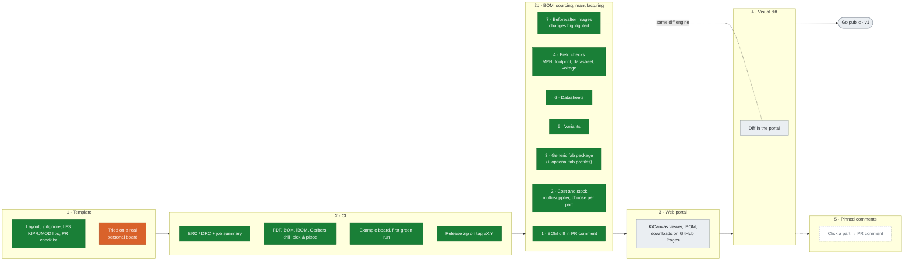

# Roadmap

Time estimates are rough, for one person.

## Where we are

**Now:** phases 2 and 2b done (BOM diff, field checks, datasheets, fab package,
variants, before/after images, cost and stock from LCSC). Left in 2b: small
extras (variant BOM diff, fab profiles, other distributors). Next: web portal.

**Legend:** green = done · orange = next / in progress · grey = planned ·
dashed = optional.

*Last update: 2026-10-29. Update the classes (`:::done`, `:::doing`, `:::todo`)
whenever a task changes state.*

## Phase 1 — Project template (~1 day)
Lives in `template/`.

- [x] Folder structure for a board repository
- [x] KiCad `.gitignore` (`*-backups/`, `fp-info-cache`, `*.lck`, `~*.lck`)
- [x] Git LFS for 3D models (`*.step`, `*.stp`, `*.wrl`) and LF line endings
      for KiCad files, in `.gitattributes`
- [x] Project libraries referenced with `${KIPRJMOD}` paths
- [x] Pull request template with a design review checklist (decoupling,
      clearances, fiducials…)
- [x] CI workflows in `template/.github/workflows/`: `kicad.yml` (every option,
      supplier keys from secrets) and `kicad-hub-cleanup.yml` (2026-10-29)
- [ ] Try it on a real personal board and adjust
- [ ] Make it usable as a GitHub template repository (or a `new-board` script)

## Phase 2 — CI (~1–2 days)
First user: one of the owner's personal boards (schematic in progress, empty PCB).

- [x] `kibot/default.kibot.yaml`: schematic PDF, BOM (CSV/HTML), iBOM. Gerbers,
      drill and pick & place moved to the fab package made with `kicad-cli` (2b.3)
- [x] Composite action `action.yml` (instead of a reusable workflow: it can ship
      the KiBot config next to it and read it from `github.action_path`)
- [x] ERC/DRC with `kicad-cli`, counts in the job summary, reports in the artifact
- [x] Board without outline → DRC and PCB outputs skipped with a warning
- [x] `strict: true` makes ERC/DRC errors fail the job
- [x] Example board with a routed PCB: `examples/royalblue54l-feather` (KiCad demo,
      CERN-OHL-P), checked on every push by `.github/workflows/test.yml`
- [x] First green run on GitHub Actions (2026-10-28, example board: all outputs OK)
- [x] Standard KiCad libraries registered for kicad-cli in the container (ERC on the
      example went from 203 to 18 findings, DRC lost 67 spurious library warnings)
- [x] Tag `vX.Y` → fabrication zip named with board name and revision, attached to
      a GitHub Release (see 2b.3; confirmed with tag v0.0.1-test, 2026-10-28)

### 2b — BOM, sourcing and manufacturing

What a reviewer and a buyer need most, ranked by value. All of it is text or files
in the CI artifact and the PR comment, so it doesn't depend on the web portal.

1. **BOM diff in the PR comment** (cheap — do first)
   - [x] Compare the BOM of the PR branch with the target branch (per reference,
         `kicad-cli sch export bom`, base checked out in a git worktree)
   - [x] Post the changes as text: added / removed table + changed fields
         (`Value: 10k → 4k7`), one sticky comment per board updated on each push
   - [x] Confirmed on a real PR on GitHub (kicad-hub #1, 2026-10-28)
2. **Cost and availability**
   - [x] Offers per part from several suppliers (`scripts/sourcing.py`): unit price
         breaks, stock, minimum order / multiple, lifecycle, link
     - LCSC and JLCPCB by the `LCSC` field, no API key (the JSON behind their web
       pages: unofficial, so failures are reported, never fatal). Checked from
       GitHub runners on 2026-10-29
     - Mouser, Farnell and DigiKey by MPN (or the MPN LCSC reports), each user with
       their own free API keys as repository secrets, passed as action inputs; a
       missing key skips that supplier. **Written from the APIs' docs, not yet run
       with real keys** — test when the owner adds keys to this repo (`test.yml`
       already passes the secrets)
   - [x] One currency for everything (`currency`, ECB rates from frankfurter.app)
   - [x] Total per board and per batch (`boards: 1,5,10,100`), per build (default and
         each variant), minimum orders, multiples and price breaks included. Per part
         and batch: the supplier chosen by the user, else the cheapest with stock
   - [x] Comparison page `sourcing.html` in the artifact: all offers per part, pick
         one, totals update; downloads the selection file and a purchase list per
         supplier. The selection lives in the board repo as `kicad-hub-sourcing.csv`
         (`Part,Supplier,SKU`), read by the CI
   - [x] Warn on not found, out of stock for the largest batch, bad lifecycle, an
         LCSC code that doesn't match the MPN, and a chosen offer no longer available
   - [x] Example board (EUR, LCSC + JLCPCB): 47 of 48 parts priced, €26.06 for one
         board, €8.09 each for 100. R5/R7 are out of stock at LCSC but JLCPCB has 17M
   - [ ] Run Mouser / Farnell / DigiKey with real keys and fix what the real
         answers show
3. **Ready-to-order package — generic, any fab house**
   - [x] One zip in standard formats every fab accepts, no vendor lock-in, built on
         every run and attached to a GitHub Release on tag `vX.Y`:
     - Gerber X2 (+ `.gbrjob`) and Excellon drill (PTH/NPTH split, drill map)
     - IPC-D-356 netlist, so the fab can run its electrical test against the design
     - Assembly: BOM (CSV with MPN, manufacturer, quantity, references, DNP) and
       pick & place (CSV, mm, top/bottom)
     - Fab notes (`README.txt`): board name, revision, layer count, thickness,
       stackup, finish, min track/space and drill, generated from the KiCad project
     - Optional ODB++ / IPC-2581 (KiCad exports both) for fabs that prefer them
   - [x] File names with board name + revision; checksum list inside the zip
   - [x] Fab notes warn when the smallest features used are below the project rules
         (example board: vias with a 0.00001 mm drill)
   - [x] Confirmed on GitHub: tag `v0.0.1-test` → release with
         `RoyalBlue54L-Feather-v0.0.1-test-fab.zip` (666 KB)
   - [ ] Fab profiles as an **optional** layer on top (`fab-profile: jlcpcb |
         pcbway | eurocircuits …`): only renames columns/files and applies that
         fab's DRC rules. Default: `generic`
4. **Checks the ERC doesn't do** (cheap — do with 1)
   - [x] Every part has MPN, footprint and datasheet (except `DNP` / not-in-BOM);
         configurable with `required-fields`, `A|B` alternatives (`MPN|LCSC`)
   - [x] Capacitors have a voltage rating field (or a value like `10uF 16V`)
   - [ ] DRC against the project's own rules by default; a fab profile can add that
         fab's rules (`.kicad_dru`)
   - [x] Report missing fields as a list in the job summary and PR comment
         (example board: 42 of 59 parts, mostly datasheet and capacitor voltage)
5. **Variants** — same design, different builds (e.g. the same board with or
   without an optional sensor)
   - [x] KiCad 10 native variants: names in `.kicad_pro` (`schematic.variants`),
         overrides per symbol instance in the schematic (`(variant (name …) (dnp yes)
         (field …))`). Input `variants: auto | list | none`
   - [x] One BOM and pick & place per variant in the fab package (`assembly/<variant>/`).
         Pick & place filtered with the schematic's per-variant DNP, because
         `kicad-cli pcb export pos --variant` reads DNP from the PCB, which may not
         be updated yet
   - [x] Report: per variant, fitted parts, parts not fitted / fitted only there and
         changed fields
   - [x] Example board: variant `lite` (no debugger: U5, U6, Y2, C18, C20 DNP; C10
         10uF as a field-change test)
   - [ ] Variant as a dimension in the PR BOM diff (today the diff is on the default build)
6. **Datasheets**
   - [x] `datasheets/index.html` in the artifact linking every part to its datasheet
         (URL and/or offline copy)
   - [x] Datasheet column as a clickable link in the KiBot HTML BOM and the iBOM
   - [x] Local datasheets resolved and copied into the artifact, so the package is
         self-contained: paths in the Datasheet field (`${KIPRJMOD}` or relative), and
         files in datasheet folders matched by MPN/value, family names included
         (`S-82A2A_B_C.pdf` → `S-82A2AAA-A8T2U`). Offline copy even when a URL exists
   - [x] Check that every datasheet link or file exists: 404/410/DNS = broken,
         sites that block bots (403, timeouts) = unverified, not counted as broken
   - [x] Generic parts (R, C, test points, holes, fiducials…) don't need a datasheet
         (`datasheet-optional-refs`)
   - [ ] (Phase 3) open the datasheet from the selected part in the web viewer
7. **Before/after images in the PR comment, with the changes highlighted**
   - [x] Render every schematic sheet and PCB layer (copper, silkscreen, outline) of
         both branches with `kicad-cli … export svg` (PCB in black and white, same
         page for both sides) and rasterize them (`rsvg-convert`)
   - [x] Pixel diff (`scripts/visual_diff.py`, PIL + numpy in the KiBot image):
         Before | After cropped to the changes, unchanged dimmed, removed in red,
         added in green, an orange box around each changed area; small changes zoomed in
   - [x] Only the sheets/layers that changed; a full-page overlay is linked too
   - [x] Images embedded in the PR comment. They are committed to the branch
         `kicad-hub-images` (`pr-<N>/`, replaced on each push) and linked by commit,
         so older versions of the comment keep working; without `contents: write`
         (e.g. PRs from forks) they stay in the artifact only (`visual/`)
   - [x] Confirmed on GitHub with a demo PR (kicad-hub #3, 2026-10-29: R5 value and
         position → nRF54L15 sheet, F.Cu and F.Silkscreen)
   - [x] Clean up `kicad-hub-images` folders of closed PRs: workflow
         `kicad-hub-cleanup.yml` (on PR close, or by hand with a PR number), in the
         template and in this repo
   - [ ] Reuse the engine for phase 4 (visual diff in the portal)

## Phase 3 — Web portal (~2–3 days)
- [ ] Static page per commit or branch on GitHub Pages
- [ ] KiCanvas viewer embedded
- [ ] Interactive BOM and downloads
- [ ] Bot comment on the PR with links: "view design", "view diff", "BOM"

## Phase 4 — Visual diff (~1–2 days)
- [ ] Kiri or KiDiff comparing the PR branch with the target branch
- [ ] Diff HTML published in the portal and linked from the PR comment

## Phase 5 (optional) — Comments on the design
The only piece no existing tool provides. A small web app on top of KiCanvas:
clicking a component creates a PR review comment through the GitHub API
(e.g. "U12 (x, y): missing decoupling").

- [ ] Prototype

This is a software project in its own right. Leave it until phases 1–4 work and
it's clear the feature is actually missed.

## Later
- [ ] GitLab port (GitLab CI + Pages + merge requests) for self-hosted teams
- [ ] Microcontroller pin map from the schematic (GPIO → net) as a table and a
      `pinout.h`, so firmware and board don't drift apart
- [ ] Notifications (e.g. Telegram) when CI finishes or a release is published
- [ ] 3D render output (slow, low value per push: maybe only on releases)

## Before going public
- [x] License: MIT (2026-10-29)
- [x] Documentation and a working example board
- [x] Third-party trademarks: no other vendors' names in the repo or its About; the
      name kicad-hub is kept with a "not affiliated with the KiCad project" note
- [x] Tags `v1.0.0` and moving `v1`; examples use `@v1`
- [ ] Owner switches the repository to public (Settings → General → Danger Zone)

## Decisions so far
- **Public under MIT, name kept** (2026-10-29): kicad-hub with a non-affiliation
  note. Versions: `vX.Y.Z` tags plus a moving major tag (`v1`) that users pin;
  `main` is development. Tags `v*` run the tests but don't attach the example's fab
  package to a release (only `example-*` tags do, to test releases).
- **Build on GitHub, not on a custom server.** Actions + Pages are free for public
  repos; nothing to host or maintain.
- **Two kinds of repositories.** This repo is the platform (reusable action +
  template). Each board lives in its own repo and calls the action.
- **Reuse existing tools** (KiBot, KiCanvas, Kiri, iBOM) instead of writing our own.
- **`kicad-cli` first, KiBot for the rest** (2026-10-28): ERC/DRC, BOMs and the fab
  package use `kicad-cli` (respects the project's saved settings, stable options);
  KiBot keeps schematic PDF, BOM HTML and iBOM. Small Python scripts on the runner
  glue it together (`scripts/`).
- **Test on a finished board** (2026-10-28): the action is developed against the
  KiCad demo `royalblue54l-feather`, not a board in progress.
- **Developed as a personal project**, with personal designs only.
- **Usefulness over copying commercial platforms** (2026-10-28): BOM diff, cost,
  ready-to-order packages, extra checks, variants and datasheets (phase 2b) come
  before the web viewer polish. Pinned comments on the board (phase 5) stay
  optional: too much work for a one-person team.
- **Fab-house agnostic** (2026-10-28): the release package uses standard formats
  (Gerber X2, Excellon, IPC-D-356, CSV BOM/CPL, fab notes) that any fab accepts.
  Vendor formats (JLCPCB, PCBWay…) are optional profiles, never the default.
- **Web portal needs public repos** (or GitHub Pro): GitHub Pages is free only
  for public repositories.
- **Prices: keyless suppliers by default, users bring their own keys** (2026-10-29):
  LCSC and JLCPCB need no key. Mouser, Farnell and DigiKey use each user's own free
  keys from their repository secrets; the tool never ships or shares keys. RS has no
  public API.
- **Supplier choice lives in a file in the board repo** (2026-10-29):
  `kicad-hub-sourcing.csv`, made with the comparison page, reviewable in PRs.
- **PR images live in a branch of the board repo** (2026-10-29): a comment can only
  show images with a URL; a `kicad-hub-images` branch needs no extra service and
  works in private repos for anyone who can read the repo.
- **Mockups** of the PR comment and the portal: `docs/mockups/`.
