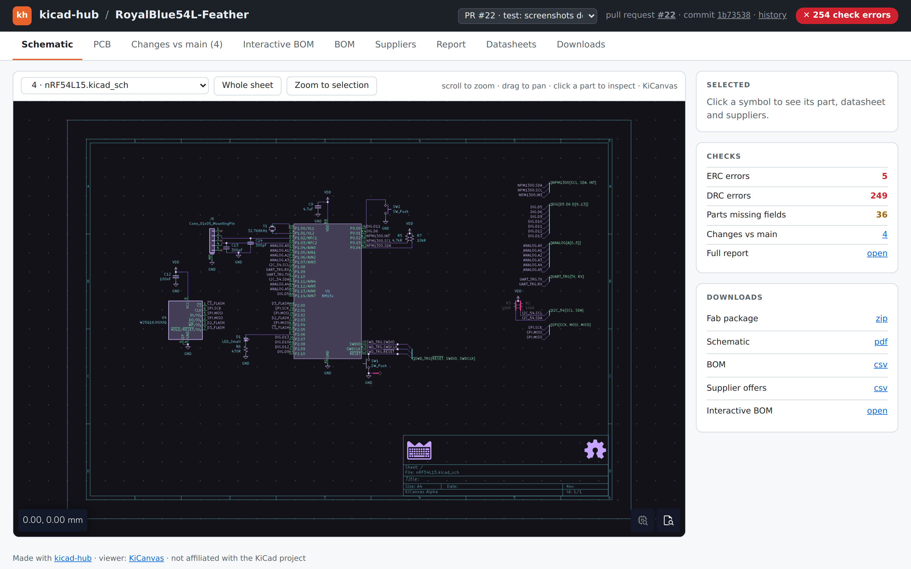
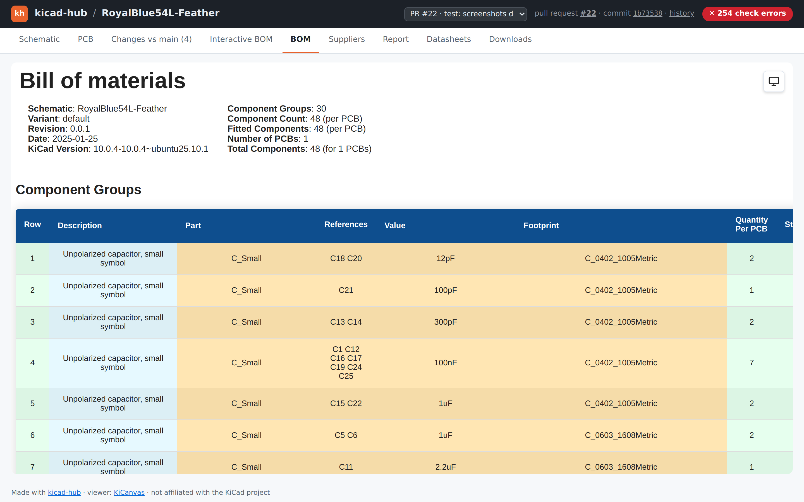
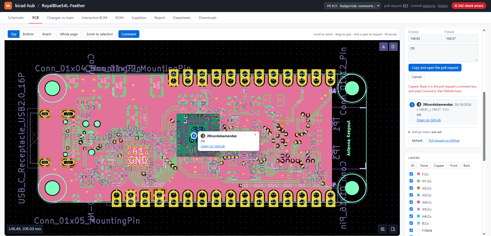

# kicad-hub user manual

For hardware designers who know KiCad and basic git, but not GitHub Actions.
Reference material (every input, every requirement check) is in the
[README](../README.md); this manual is the step-by-step version.

Contents: [1 What you get](#1-what-kicad-hub-gives-you) ·
[2 New board](#2-create-a-new-board-project) ·
[3 Existing project](#3-add-kicad-hub-to-an-existing-kicad-project) ·
[4 Day-to-day](#4-day-to-day-workflow) ·
[5 The portal](#5-using-the-portal) ·
[6 Suppliers, variants, requirements, fab profiles](#6-suppliers-variants-requirements-and-fab-profiles) ·
[7 Releasing](#7-releasing-a-board-revision) ·
[8 Troubleshooting](#8-troubleshooting-and-faq)

---

## 1. What kicad-hub gives you

You push KiCad files to GitHub; kicad-hub (a GitHub Action running KiCad 10 in a
container) checks the design and publishes the results. Nothing to install on your
PC and no server to maintain.

| You do | You get |
|---|---|
| Push a branch / open a pull request (PR) | ERC and DRC, BOM checks, BOM diff against the target branch, before/after images of changed sheets and layers, prices and stock, variants, requirements table: all in **one PR comment**, updated on every push |
| Open the link in that comment | The **design portal**: schematic and PCB in the browser, interactive BOM, supplier comparison, report, datasheets, downloads, comparison between any two versions, activity graph |
| Tag `v1.0` | A **GitHub Release** with the fab zip (Gerber X2, Excellon, IPC-D-356, BOM and pick & place, fab notes, checksums) |


The PR comment (checks, BOM changes, visual changes, variants, cost, fab package):


Interactive compare of a changed sheet, and the BOM tab:






A live example: <https://jmcordobamendez.github.io/kicad-hub/>.

---

## 2. Create a new board project

### 2.1 Create the GitHub repository

1. On github.com: **+** (top right) → **New repository**.
2. Name it after the board. Choose **Public** or **Private**.
3. Leave "Add a README", `.gitignore` and licence **unchecked** (the template brings
   its own files). **Create repository**.

| | Public | Private |
|---|---|---|
| Checks, PR comment, before/after images, fab package artifact, releases | yes | yes |
| Design portal served on GitHub Pages | yes, free | only with a paid GitHub plan |
| Environments with required reviewers (release approval) | yes | paid plans only |

In a private repository without Pages, the portal is still built and pushed to the
`kicad-hub-site` branch, but nobody can open it as a web page. Everything else works.

### 2.2 Copy the template

1. Clone your new empty repository:
   ```
   git lfs install          # once per machine
   git clone https://github.com/<you>/<board>.git
   ```
2. Copy the contents of [`template/`](../template/) into it (including the hidden
   `.github/`, `.gitignore` and `.gitattributes`).
3. Copy your KiCad project (`.kicad_pro`, `.kicad_sch`, `.kicad_pcb`, sheets) into the
   root, or into a subfolder (then set `project-dir`, see 2.3).

What the template gives you:

| File / folder | Purpose |
|---|---|
| `.gitignore` | Ignores KiCad backups, caches, lock files and `fab/` (outputs are generated by CI, never committed) |
| `.gitattributes` | LF line endings for KiCad files (clean diffs across OSes) and **Git LFS** for 3D models (`*.step`, `*.stp`, `*.wrl`) |
| `lib/project.kicad_sym`, `lib/project.pretty/`, `lib/3d/` | Board-specific symbols, footprints and 3D models |
| `sym-lib-table`, `fp-lib-table` | Register those libraries as `${KIPRJMOD}/lib/...`, so the project opens on any machine with no setup |
| `.github/pull_request_template.md` | Design review checklist shown in every PR |
| `.github/ISSUE_TEMPLATE/` | Forms: part request, design review, fab release |
| `.github/CODEOWNERS.example` | Who must approve changes to which file (optional) |
| `.github/workflows/kicad.yml` | The CI workflow |
| `.github/workflows/kicad-hub-cleanup.yml` | Removes a closed PR's images and portal page |
| `kicad-hub-requirements.yaml` | Commented requirements (optional) |
| `docs/approvals.md` | Recipes for branch rules and release approval |

Tips: reference 3D models as `${KIPRJMOD}/lib/3d/<model>.step`; in KiCad's footprint
and symbol library managers use the project tables, not global ones, for anything the
board needs.

### 2.3 Edit `kicad.yml`

Open `.github/workflows/kicad.yml`. Usually you only change:

| Option | When |
|---|---|
| `project-dir` | The `.kicad_pro` is not at the repository root (e.g. `hardware/my-board`) |
| `strict: true` | You want the job to fail on ERC/DRC errors or a failed requirement |
| `currency` | Prices in EUR, etc. (default USD) |
| `fab-profile` | `jlcpcb`, `pcbway` or `eurocircuits` (see 6.4) |
| `boards` | Batch sizes to price (default `1,5,10,100`) |
| `history`, `activity` | Defaults are 10 and 500; `0` turns each off |
| supplier keys | See 2.7 |

The workflow runs on pushes to `main`, on every pull request and on tags `v*`.
If your default branch is not called `main`, change `branches: [main]`.

### 2.4 First commit and push

```
git add .
git commit -m "chore: initial board and kicad-hub"
git push -u origin main
```

If `git push` is rejected for the workflow file, you need to sign in with a token or
credential that is allowed to write workflows (the normal GitHub login in Git Credential
Manager works).

### 2.5 Repository settings

Before or right after the first run:

1. **Settings → Actions → General → Workflow permissions** → **Read and write
   permissions** → **Save**. (The workflow also declares `contents: write` and
   `pull-requests: write`; an organisation policy set to read-only overrides it.)
2. **Actions → Allow actions** must permit `actions/checkout` and
   `JMcordobamendez/kicad-hub` (the default "Allow all actions" does).

### 2.6 Watch the first run and enable Pages

1. Open the **Actions** tab → the **KiCad** run. The first run downloads the
   container image, so it takes a few minutes.
2. Open the run: the **summary** shows the report; **Artifacts** at the bottom has
   `<board>-fab` (zip with everything).
3. When the run finishes, the `kicad-hub-site` branch exists. Turn Pages on once:
   **Settings → Pages → Build and deployment → Source: Deploy from a branch →
   Branch: `kicad-hub-site` / `(root)` → Save**.
4. After a minute the portal is at `https://<you>.github.io/<repo>/`
   (the Pages settings page shows the exact URL). Push another commit, or re-run the
   job, if the front page is empty.

### 2.7 Optional: supplier prices, requirements, fab profile

LCSC and JLCPCB prices work with no setup (parts are looked up by their `LCSC` field,
e.g. `C25744`). To add more suppliers, get a free API key from each, then store it as
a secret: **Settings → Secrets and variables → Actions → New repository secret**.
The template already passes them to the action; a secret that is not set is skipped.

| Supplier | Secret name(s) | Where to get it |
|---|---|---|
| Mouser | `MOUSER_API_KEY` | [mouser.com/api-hub](https://www.mouser.com/api-hub/) → sign up for the **Search API**. Not the Cart or Order API key: that one will not work |
| Farnell / element14 | `FARNELL_API_KEY` (+ `farnell-store` in the workflow, e.g. `es.farnell.com`) | [partner.element14.com](https://partner.element14.com/) → Product Search API (REST) |
| DigiKey | `DIGIKEY_CLIENT_ID`, `DIGIKEY_CLIENT_SECRET` | [developer.digikey.com](https://developer.digikey.com/) → organization → **Production App** with **ProductInformation V4** enabled (callback `https://localhost` is fine) |

Mouser, Farnell and DigiKey parts are searched by the `MPN` field, so fill `MPN` in
your symbols. Mouser allows 30 requests per minute and 1,000 per day. PRs from forks
get no secrets (priced with LCSC/JLCPCB only).

Other optional files and settings: requirements (6.3), fab profile (6.4), the
`history` and `activity` inputs (5.8, 5.9).

---

## 3. Add kicad-hub to an existing KiCad project

If the project is already in a GitHub repository:

1. Create a branch: `git switch -c chore/add-kicad-hub`.
2. Copy from [`template/`](../template/) into your repository, keeping paths:
   - `.github/workflows/kicad.yml` and `kicad-hub-cleanup.yml` (required);
   - `.github/pull_request_template.md`, `ISSUE_TEMPLATE/`, `CODEOWNERS.example` (optional);
   - `.gitignore` and `.gitattributes`: **merge** with yours rather than overwrite;
   - `kicad-hub-requirements.yaml` next to the `.kicad_pro` (optional).
3. Edit `kicad.yml`: set `project-dir` to the folder with the `.kicad_pro`.
4. If you already have 3D models in git, check the LFS rules in `.gitattributes` first:
   adding LFS rules does not convert files already committed
   (`git lfs migrate import --include="*.step,*.stp,*.wrl"` does, but rewrites history:
   ask your team first).
5. Make the project self-contained: library tables using `${KIPRJMOD}` (as in the
   template's `fp-lib-table`/`sym-lib-table`), so CI can open it. Footprints or 3D models
   that only exist in your global libraries will show as missing in CI.
6. Apply sections 2.5 and 2.6 (permissions, Pages), commit, push the branch and open a
   PR: the PR itself is the first run, and the comment links to the portal page.
   The Pages setting in 2.6 step 3 needs the `kicad-hub-site` branch, which appears
   after the first run; the portal only goes live once Pages is on.

If the project is not under git yet: create the repository (2.1), copy the project in,
then do section 2.2 onwards.

---

## 4. Day-to-day workflow

1. **Branch per change**, from `main`: `git switch -c feat/new-ldo`.
   Work in KiCad, save, commit.
2. **Push** the branch: `git push -u origin feat/new-ldo`. The workflow runs and
   publishes the branch page at `/<branch>/` of the portal.
3. **Open a PR** into `main` (GitHub offers a button after the push; fill the checklist).
4. **Read the bot comment** (it updates on every push):

   | Section | What to look at |
   |---|---|
   | Check table | ERC and DRC errors and warnings |
   | BOM changes vs `main` | Parts added, removed, changed (`Value: 10uF → 22uF`) |
   | Visual changes | Before/after of each changed sheet and PCB layer: removed in red, added in green, changed area boxed |
   | Variants | What each design variant fits, leaves out or changes; warnings such as "value changed but part number kept" |
   | Requirements | Pass/fail table from `kicad-hub-requirements.yaml` |
   | Fab DRC | Second DRC with the fab's published limits (when `fab-profile` is set) |
   | Cost and stock | Cost per board per batch; parts out of stock, obsolete or not found |
   | Fab package | Files in the artifact and "check before ordering" warnings |
   | Missing fields / Datasheets | Parts lacking footprint, datasheet, MPN/LCSC, capacitor voltage; broken datasheet links |

5. **Open the PR's portal page** (the first link of the comment, "Open this design in
   the browser") and review in the **Changes vs main** tab: pick a changed sheet or
   layer and use *swipe*, *fade*, *side by side* or *changes* (red only before, green
   only after); zoom and pan.
6. **Pin comments on the board**: **Comment** button on the PCB/Schematic tab, click a
   part or point, write, post (needs a token, see 5.10; without one the formatted comment
   is copied for you to paste in the PR).
7. **Fix**: commit and push again; the comment and portal page update.
8. **Merge** once ERC/DRC, requirements and reviewers are happy. Merging into `main`
   publishes the `main` page and adds a snapshot to History.

**Merge commit or squash?** Prefer **merge commits** (*Merge pull request* button).
- Merge commit: the branch's commits stay in `main`'s history, the Activity graph shows
  the branch lane and its merge curve, and every commit can appear in History and be
  compared.
- Squash: `main` gets one new commit; the branch's own commits are not on `main`, so the
  graph shows a single dot with no lane, and History/Compare only offer the squashed
  version.

Both work; squash just loses detail in the graph and the timeline.

Optional but recommended (details in
[`template/docs/approvals.md`](../template/docs/approvals.md)): protect `main` with a
ruleset (**Settings → Rules → Rulesets**) requiring a PR, one approval and the `board`
check.

---

## 5. Using the portal

Address: `https://<owner>.github.io/<repo>/`. The front page lists branches,
pull requests and releases; each has its own page:
`/<branch>/` (e.g. `/main/`), `/pr-<N>/`, `/releases/<tag>/`.

### 5.1 Top bar and version picker

The top bar shows the board, the version you are viewing (branch, PR number, commit),
the check status and links to History and Activity. The **version picker** jumps between
branches, `main`'s history, releases and PRs, and opens the timeline or compare page.

### 5.2 Schematic

Sheet picker to switch between hierarchical sheets; pan, zoom, click a symbol to see it
in the side panel. With design variants there is a **Variant** picker too (see
[6.2](#62-variants)): the symbols not fitted in the chosen variant get KiCad's DNP cross, on
every sheet.

**Cross-probing** (the Schematic and PCB tabs work together, see also 5.3):

- Click a symbol: **Show on PCB** switches to the PCB tab, turns the board to the side the
  footprint is on, selects it and zooms to it. Power symbols, parts excluded from the board
  and parts without a footprint on the board get a message instead. A part not fitted in the
  chosen variant is still shown, with a note (its footprint stays on the board, drawn as DNP).
- A multi-unit part lists its other units under the buttons: click one to open it.
- Once the PCB tab has been opened, the nets of the selected part are listed under the
  button: click one to highlight it on the board. KiCanvas only lets you pick symbols, not
  labels, wires or pins, so there is no "click a net" in the schematic.
- After **Show in schematic** for a net (see 5.3) a **Net in the schematic** card lists the
  sheet being shown ("Sheet 2 of 3"); **Prev sheet / Next sheet** walk through the sheets
  where the net is, **Show on PCB** highlights it on the board again and **Clear** or **Esc**
  removes the rings.
- **Sync** (toolbar, off by default, kept in the link as `?sync=1`): selecting a part in one
  tab selects it in the other, so switching tabs lands on it.

### 5.3 PCB

- **Top / Bottom** flips the board; **Board**, **Whole page**, **Zoom to selection** change the view.
- **Layers** card: tick to show or hide; presets **All**, **None**, **Copper**, **Front**, **Back**;
  **click a layer's name to bring it to the front**.
- **Selected** panel (click a footprint): reference, value, footprint, **nets** of its pads,
  the **datasheet** (local copy if found) and the best **supplier offers**. With a variant
  chosen it shows that variant's values and offers (see **Variant** below).
- **Variant** (only if the design has variants): the footprints not fitted in the chosen
  variant are covered by a hatched box with a red X and a "DNP" label (just a faint outline
  for the side of the board you are not looking at). The overlay never catches clicks, so
  selecting, Measure and the nets work as usual. See [6.2](#62-variants).
- **Nets**: click a net in the Selected panel, a track on the board, or search it in the
  **Nets** card (type-ahead over every net). The net's tracks, vias, pads and zones are
  highlighted and the rest dimmed; the card shows its pads, tracks (with length), vias and
  zones. **Prev / Next pad** centres each pad in turn ("J3 pad B6 · 2 of 5", turning the
  board for the other side); **Fit** frames the whole net; **Clear** or **Esc** ends it.
- **Cross-probing**: with a footprint selected, **Show in schematic** (Selected panel)
  switches to the Schematic tab, opens the sheet that has the symbol (looked up on every
  sheet, also on hierarchical sheets used more than once), selects it and zooms to it.
  With a net highlighted, **Show in schematic** (Nets card) goes to the sheets where the net
  is and draws a ring on each connected pin (yellow) and on each label or power symbol of
  the net (orange), because KiCanvas has no net highlight in the schematic. The pins come
  from the board's pads and the labels from their names, so a net with no label and no pin
  on a symbol gets a message instead. It works on branch, release, history and PR pages, and
  follows the chosen variant. Comment and Measure keep working: the buttons act on a normal
  selection and do not start or end those modes.
- **Measure** (PCB and schematic): press **Measure**, click point A, then point B. The
  distance and its dx / dy legs are drawn and shown in the toolbar (on the PCB, points snap
  to a pad centre nearby). **Esc** clears. Measure and **Comment** are exclusive modes.
- The viewer is [KiCanvas](https://kicanvas.org), still alpha: some KiCad features may not
  draw exactly as in KiCad.

### 5.4 Changes (PR pages only)

"Changes vs main (n)": BOM changes plus each changed sheet or layer in the interactive
compare (swipe, fade, side by side, changes).

### 5.5 Interactive BOM, BOM, Suppliers

| Tab | Use |
|---|---|
| Interactive BOM | iBOM: click a row to see the part highlighted on the board |
| BOM | Grouped parts list with fields, flagged where required fields are missing |
| Suppliers | Offers per part and supplier (stock, minimum order, unit price), totals per batch. To *choose* suppliers see 6.1 |

### 5.6 Report and Datasheets

**Report**: the same content as the PR comment. **Datasheets**: link status (OK, broken,
unverifiable), local PDFs found by MPN or value and bundled for offline use.

### 5.7 Downloads

Fab package zip, schematic PDF, BOM CSV and the commit history of that build.

### 5.8 History and Compare

- **History** (front page, `#history`): the last commits of `main` (input `history`,
  default 10) and the releases, newest first, with ERC/DRC status and **Open**,
  **Compare with previous**, **Compare with…**. Snapshots are light: design files (if
  under 6 MB), page renders, BOM; no fab package, offers or PDFs. Releases keep full pages.
- **Compare** (`compare.html`): pick any two versions (`main/`, `history/<sha>/`,
  `releases/<tag>/`, `pr-N/`). It shows BOM changes and every schematic sheet and PCB
  layer in the interactive compare. Identical pages are collapsed. Builds published
  before the compare feature have no renders until their next publish.

### 5.9 Activity

`activity.html`: a lane graph of the last commits (input `activity`, default 500) of
all branches and tags, next to a feed of pull requests (opened, reviewed, commented,
merged, closed), pushes and releases.

- Hover an item to highlight its commits (and the reverse). Click a commit for **Open
  design** (if a page was published for it) and **Compare with parent**, or open it on GitHub.
- Filters: branch, author, dates, "only main + open PRs".
- **Pushes are recorded since the install** (GitHub does not keep who pushed): the page
  says since when. Earlier pushes are not known.
- **No e-mail addresses are published**: authors are shown by GitHub login or commit name,
  and anything that looks like an address is stripped from messages.
- PR data needs the action's `github-token` (the default works); without it the page shows
  the git graph alone. PRs from forks never appear.

### 5.10 Pinned comments (PR pages)

Pin a review note to a part or a point of the board; it is posted as a comment on the
pull request and drawn back on the board for everyone.



**Make a comment** (PCB or Schematic tab of a PR's page):

1. Press **Comment** in the viewer toolbar.
2. Click a part (its reference is filled in) or any empty point of the board. The form in
   the side panel shows **Part**, **Layer**, **X / Y (mm)**; you can still edit them, and
   clicking the board again moves the pin. **Esc** or **Cancel** stops.
3. Write the note.
4. Post it:
   - **Without a token**: **Copy and open the pull request** copies the formatted comment
     and opens the PR. Paste it in the comment box at the bottom and press **Comment**.
     Back on the portal the comment is read again on its own (or press **Refresh**) and
     the form closes when it appears.
   - **With a token** (see below): **Post to the pull request** posts it directly.

What it looks like on GitHub:

```
📍 **U2** (x 146.85, y 104.57 mm, F.Cu) — missing decoupling
[Open on the board](https://<owner>.github.io/<repo>/pr-21/?at=146.85,104.57&ref=U2#pcb)
```

plus a hidden `<!-- kicad-hub-pin {...} -->` marker with the coordinates, layer and commit
(not shown by GitHub; the portal reads it).

**Read comments**: the **Comments** card lists every pinned comment of the PR (number,
author, part, coordinates, text, link to GitHub); the same numbers appear as markers on
the board, following zoom, pan and Top/Bottom (pins on the other side are dimmed).
Clicking a marker or a list entry zooms to it; **Open on the board** links in the PR land
on the same spot. A comment made on an older commit is flagged "older commit".

**Posting from the page** needs a fine-grained token (one time, in GitHub):

1. Profile photo (top right) → **Settings** → **Developer settings** (bottom of the left
   sidebar).
2. **Personal access tokens → Fine-grained tokens → Generate new token**.
3. Name `kicad-hub comments`, expiration 30 days.
4. **Resource owner**: the owner of the board repo. **Repository access → Only select
   repositories** → the board repo.
5. **Repository permissions → Pull requests → Read and write** (nothing else).
6. **Generate token**, copy `github_pat_…`, paste it in the **GitHub token** box of the
   Comments card → **Save**. **Forget token** removes it.

The token stays in your browser's local storage and goes only to `api.github.com`. Keep
the expiry short and the scope to one repository. Known limits: the page only creates
conversation comments (no replies or resolve), a pin keeps its position even if the part
later moves, and it relies on KiCanvas internals.

---

## 6. Suppliers, variants, requirements and fab profiles

### 6.1 Choosing suppliers

By default each part uses the cheapest supplier with enough stock for the batch. To pick:

1. Download the run's artifact `<board>-fab` and open **`sourcing.html`**.
2. Choose an offer per part (or *Use the cheapest for every part* to freeze the current
   choice). **Download purchase list** gives one CSV per batch, per supplier, ready for the carts.
3. **Download selection file** and commit it as **`kicad-hub-sourcing.csv`** next to
   the `.kicad_pro` (columns `Part,Supplier,SKU`; editable by hand and reviewable in PRs).

From then on the totals use your picks; parts not listed stay automatic.

**Target prices.** Add an optional `Target` column (unit price in the action's `currency`)
to `kicad-hub-sourcing.csv`, or type it next to each part in `sourcing.html` before
downloading the selection file. A row can carry only a target (`Part,,,Target`), with no
supplier chosen:

```csv
Part,Supplier,SKU,Target
C307331,,,0.005
C96446,LCSC,C96446,0.05
```

The report then lists the parts whose price at each batch is above target ("Above target
price": target, price used, supplier, +%), and `sourcing.html` marks those offers in red.

### 6.2 Variants

KiCad 10 design variants are read from the project (input `variants`: `auto` = all,
a list, or `none`). The report lists what each variant fits, omits or changes, diffs each
variant in PRs, and the fab package gets a BOM and pick & place per variant under
`assembly/<variant>/`.

Pick & place is filtered with the schematic's per-variant DNP, because
`kicad-cli pcb export pos --variant` reads DNP from the PCB, which may not be updated yet.
So the report adds a **Schematic vs PCB** line per build (default and each variant): "in
sync", or a table (ref, what the schematic says, what the PCB says) covering DNP, "exclude
from BOM" / "exclude from position files", references present on one side only and value
differences, using the PCB's per-variant overrides if the board file stores them. Fix it in
KiCad with *Tools → Update PCB from Schematic*. Variants are compared only when the PCB stores per-variant data; otherwise the report
says "not checked" for them and only the default build is compared. It never fails the build by itself (add the
`variants_in_sync` requirement for that), the number is `variant_sync_issues` in
`counts.json`, and the fab package `README.txt` warns when a build's pick & place
disagrees with the PCB.

**Variant picker in the portal.** If the design has variants, the toolbar of the Schematic
and PCB tabs shows **Variant: default | lite | …**. The choice is shared by both tabs and
kept in the address (`?variant=lite`: send that link and it opens on that variant; it works
on `main`, release, history and PR pages). Next to the picker, a legend reads e.g.
"lite: 16 parts not fitted (11 in default) · 1 changed" (hover for the references).

- **PCB**: each footprint not fitted is covered by a hatched grey box with a red X and a
  "DNP" label over its courtyard; those on the other side of the board are faint outlines.
- **Schematic**: the symbols not fitted get KiCad's DNP look (a red X over the symbol), on
  whichever sheet you are viewing.
- **Selected** panel: the variant's own values (`10uF (default: 100nF)`), "Not fitted in
  lite" for a part left out (and no offers: it is not ordered), and the offers of the part
  the variant orders, if they differ from the default.

The data comes from the per-variant BOMs the action already builds, so what you see is what
the report and the fab package use, not what the PCB's own DNP flags say.

### 6.3 Requirements

Put `kicad-hub-requirements.yaml` next to the `.kicad_pro` and uncomment what you need.
Each entry has `id`, `text`, `check` and parameters:

```yaml
- id: R1
  text: Cost per board under 15 EUR at 100 units
  check: max_cost
  batch: 100
  max: 15
```

Checks: `erc_errors_max`, `drc_errors_max`, `max_parts`, `max_unique_parts`, `max_cost`,
`in_stock`, `no_bad_lifecycle`, `max_layers`, `max_board_size`, `min_track`, `min_drill`,
`required_fields`, `forbidden_parts`, `variants_in_sync` (schematic vs PCB differences;
default max 0), `max_above_target` (parts above their target price;
default max 0) — parameters in the README. Result is **pass**, **fail**
or **unknown** (missing data: never fails the job). Failed requirements fail the job only
with `strict: true`. No file = nothing checked.

### 6.4 Fab profiles

`fab-profile: jlcpcb | pcbway | eurocircuits` adds a second DRC with that fab's published
limits (never fails the build; `reports/drc-fab.*`), a note in the package `README.txt`,
and for `jlcpcb` BOM and CPL in JLCPCB's columns (needs the `LCSC` field). Values are from
public pages and cited in each `rules.kicad_dru`; always confirm with your fab.

---

## 7. Releasing a board revision

1. Make sure `main` is green and the PR checklist, ERC/DRC and requirements are clean.
   Update the revision in the title block and silkscreen.
2. Tag and push:
   ```
   git switch main && git pull
   git tag v1.0
   git push origin v1.0
   ```
   (or *Releases → Draft a new release* on GitHub, creating the tag there).
3. The workflow publishes a **GitHub Release** (**Releases** on the repo's right side) with
   `<board>-<tag>-fab.zip`, and a full portal page at `/releases/<tag>/`.

**Inside the zip:** `gerber/` (Gerber X2 + `.gbrjob`), `drill/` (Excellon PTH/NPTH + maps),
`assembly/` (BOM and pick & place CSV, per variant, plus per-fab files with a profile),
`*.d356` (IPC-D-356 netlist), `README.txt` (size, layers, stackup, finish, smallest
features, warnings), `SHA256SUMS.txt`.

**Ordering checklist**
- [ ] The release's report has no unexpected ERC/DRC errors; fab DRC clean for your fab
- [ ] "Check before ordering" warnings in `README.txt` read and accepted
- [ ] Layers, thickness and finish in `README.txt` match what you order
- [ ] Open the Gerbers in a viewer once; compare against the portal's PCB tab
- [ ] BOM: every part in stock for the quantity, correct variant's files used
- [ ] Revision on the silkscreen equals the tag
- [ ] Checksums verified after download

**Optional approval:** to require a reviewer before a tag publishes, create the GitHub
Environment `fab-release` (**Settings → Environments → New environment**, tick *Required
reviewers*) and enable the commented `release` job in `kicad.yml`. Steps in
[`template/docs/approvals.md`](../template/docs/approvals.md) (section 5). The run then
waits at **Review deployments** until approved. Required reviewers in private repos need
a paid plan.

---

## 8. Troubleshooting and FAQ

| Problem | Cause and fix |
|---|---|
| Run failed | **Actions** → the run → the red step. Often: the `.kicad_pro` is not where `project-dir` says; or Workflow permissions are read-only (2.5); or `strict: true` with errors |
| Portal URL gives 404 | Pages not enabled, or wrong branch: **Settings → Pages**, source `kicad-hub-site` / `(root)`. Needs at least one successful run, and a few minutes to deploy. Private repo without a paid plan: not served |
| Front page is empty | Pages was enabled before the first publish; push a commit or re-run |
| No PR comment | `pull-requests: write` missing, or the PR comes from a **fork** (forks can't write and get no secrets or portal page) |
| KiBot warnings in the log | Usually non-fatal (e.g. an unannotated part is a warning; the rest is published). A board with no outline on `Edge.Cuts` skips DRC and PCB outputs with a warning |
| Parts or 3D models missing | Libraries not in the project tables with `${KIPRJMOD}`, or 3D models not pushed/LFS missing (`actions/checkout` needs `lfs: true`, set in the template) |
| "Click or tap to interact" over the viewer | Normal: KiCanvas waits for a first click before it takes the mouse wheel, so the page can scroll. Click once inside the viewer, then scroll to zoom and drag to pan |
| Private repository | Checks, PR comment, artifacts and releases work; portal needs Pages on a paid plan (or download the artifact) |
| Prices missing | Part has no `LCSC` (or `MPN` for Mouser/Farnell/DigiKey), or the secret is not set. Mouser: use a **Search API** key. Mouser limit 1,000 requests/day |
| Pinned comments do not load | Anonymous GitHub API limit is 60 requests per hour per IP: wait, or save a token (5.10) |
| Clean up a closed PR | Automatic via `kicad-hub-cleanup.yml` (removes `pr-<N>/` from the portal and its images). For an old PR: **Actions → Clean up PR outputs → Run workflow** with the PR number. Old PR comments keep their images (they link to a commit that stays in history) |
| Re-run | **Actions** → the run → **Re-run all jobs**; or push an empty commit (`git commit --allow-empty -m "ci: rerun"`). Release: re-run the tag's run |
| The `kicad-hub-site` / `kicad-hub-images` branches | Generated: a single commit replaced on every publish. Do not edit or merge them |
| Version pinning | `@v1` follows 1.x; use `@v1.1.0` to freeze, `@main` for development |

**Known limits:** no real-time co-editing (split the schematic by sheet, one PCB owner at a
time); Pages is free only for public repos; KiCanvas is alpha; pinned comments are a
prototype.
